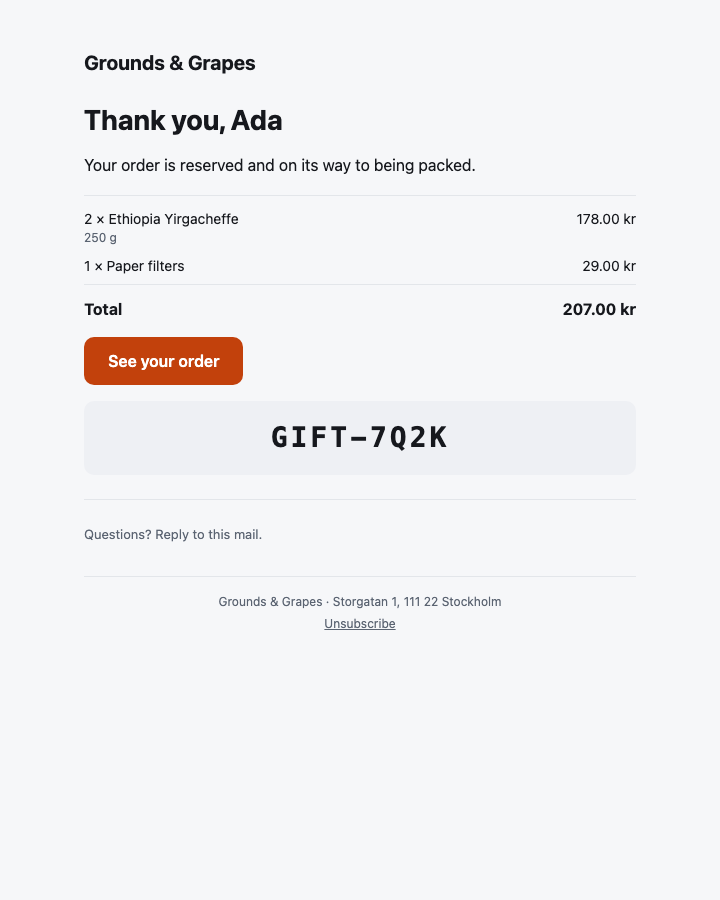

# Osysharp.EmailTemplates — mail that looks designed, rendered from data

## Use case

Your app sends mail about something a person did: an order confirmation, a shipping notice, a refund, a code to
redeem, a reminder. This package makes that mail look like it came from a designed product instead of a script — a
branded page with a clear headline, the lines of a receipt with their amounts, one obvious button, and a footer with
the sender's address — and it fills it from your data.

It renders on the server, in the app's own theme, into HTML every mail client lays out (tables, every style inline, no
script, no web font) and a plain-text twin that says the same thing. It formats mail; it does not send it — hand the
result to whatever sends your mail (`Osysharp.Resend`, or any provider).



*A shop's receipt, photographed by `osy test --pixels` from this package's own tests.*

## Install and use

```osy
app Shop {
  use Osysharp.EmailTemplates@0;
  model "model/**/*.osy";
}
```

A mail is an `[Email]` component with a `subject =>`. Calling it from any function — a workflow step included —
answers a `RenderedEmail` with `Subject`, `Html` and `Text`:

```osy
using Osysharp.EmailTemplates;

[Email]
public component OrderConfirmation(Order order) {
  subject => $"Your order {order.Reference}";
  render {
    EmailLayout("Grounds & Grapes", preview: $"Order {order.Reference} is reserved for you",
                address: "Storgatan 1, 111 22 Stockholm") {
      EmailHeading($"Thank you, {order.CustomerName}");
      EmailText("Your order is reserved and on its way to being packed.");
      EmailTable() {
        foreach (var line in order.Lines) {
          EmailRow($"{line.Quantity} × {line.Name}", Money(line.Price * line.Quantity), detail: line.Size);
        }
        EmailTotal("Total", Money(order.Total));
      }
      EmailButton("See your order", $"https://shop.example.com/orders/{order.Reference}");
    }
  }
}

void SendConfirmation(Order order) {
  var mail = OrderConfirmation(order);
  new ResendMailer { ApiKey = Secret.ResendApiKey, From = "Shop <shop@example.com>" }.Send(new EmailMessage {
    To = [order.Email], Subject = mail.Subject, Html = mail.Html, Text = mail.Text,
  });
}
```

## What it ships

| part | what it draws |
|---|---|
| `EmailLayout(brand, preview?, logo?, address?, unsubscribe?, footer?) { … }` | the frame: the app's own page in a 600-pixel column, with the brand (or its logo) at the top, the mail inside, and a footer with the sender's address and — for a mail a reader signed up to — an unsubscribe link |
| `EmailHeading(text)` | the headline, in the theme's display face |
| `EmailText(text)` | a paragraph; a line break is kept |
| `EmailNote(text)` | small print in the muted colour |
| `EmailButton(label, href)` | the one thing to do next — a button that is a link in every client, Outlook included |
| `EmailImage(src, alt, width?)` | a picture by address; a path is sent as the app's absolute address |
| `EmailCode(code)` | a code to type or read out — a gift code, a return code — large and spaced |
| `EmailDivider()` | a rule |
| `EmailTable() { … }` | a receipt's lines — `EmailRow`s and an `EmailTotal` |
| `EmailRow(label, value, detail?)` | one line: what it is (and a detail under it) and what it costs |
| `EmailTotal(label, value)` | the line a receipt ends on, bold, under a rule |

Every colour, size and face is a theme token (`Colors.Primary`, `FontSize.Title`, `Radius.Md`), and the renderer
writes the **app's** value for each into the mail — so a shop whose brand is orange sends orange buttons.

### The mail blocks — what staff arrange

A mail's words that staff own are a `Region` of blocks (`use Osysharp.Blocks;` in the app), arranged at the page desk
(`Osysharp.Pages`) like a page's — a draft, published, in each language, with the mail itself previewed beside it. The
kit ships the everyday blocks, each an `[Email]` part marked `[Block]` whose words fill the mail's `{placeholders}`:

| block | staff fill in |
|---|---|
| `EmailWords` — Words | a paragraph in Markdown |
| `EmailHeadline` — Heading and words | a heading and a paragraph under it |
| `EmailPicture` — Picture | a photograph (one the app ships, or an upload) and what it shows |
| `EmailAction` — Button | what it says and where it goes |
| `EmailQuote` — Quote | what somebody said, who, and one of the theme's grounds |
| `EmailSmallPrint` — Small print | a quiet line at the foot |

```osy
[Email]
public component Welcome(Member member) {
  subject => $"Welcome, {member.Name}";
  placeholders { member.name => member.Name; }
  render {
    EmailLayout("The Rowing Club") {
      Region("welcome", allow: [EmailWords, EmailPicture, EmailQuote], sample: WelcomeSample) {
        EmailWords(words: "Welcome aboard, **{member.name}**.");
      }
    }
  }
}
```

An app that arranges nothing uses them as ordinary parts and needs no `Osysharp.Blocks`.

## Make it yours

Each part is an ordinary `[Email]` component, so a different button is a component of your own written the same way,
over the platform's email atoms (`Stack`, `Row`, `Box`, `Text`, `Link`, `Image`, `Divider`, `Spacer`, `Markdown`,
`Preview`). `osy get EmailButton` copies this one into your app to start from.

The reference: `osy docs ui-email` (the `[Email]` render target) and `osy docs ui-email-templates-kit` (this package).

## Source

`model/Parts.osy` (the parts) and `model/Blocks.osy` (the mail blocks) — two files of Osy#.
